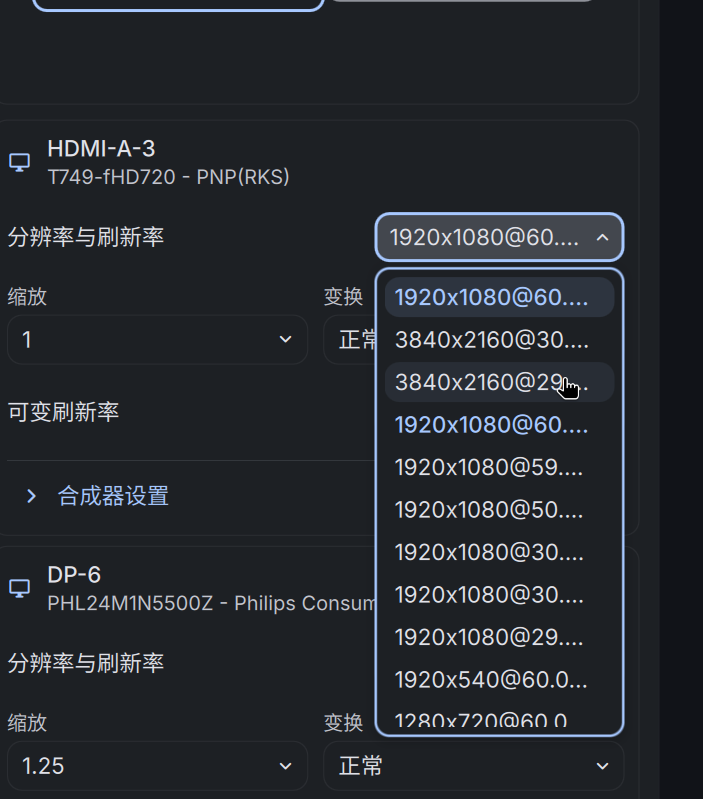
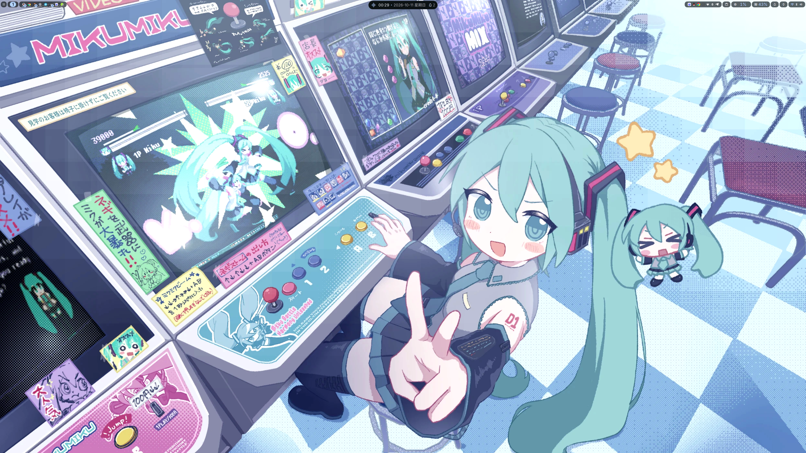

**用到的设备**：
- [Radxa的rk628h模块](https://docs.radxa.com/accessories/display/hdmi-in-to-mipi-csi2)
- [luckfox aura rv1126b开发板](https://wiki.luckfox.com/zh/Luckfox-Aura/Introduction)
- [Radax 31pin to rpi 22pin转接线](https://item.taobao.com/item.htm?id=773917734723&mi_id=0000wll-s4BybM6jpM6Nizy8WJa6EvTZ4BlEfwGcf-y7xck&skuId=6221462787429&spm=tbpc.boughtlist.suborder_itemtitle.1.63242e8dBU6pje)

## 一、前置准备
截至26年10月，radxa针对这个rk628h模块只适配了rock4d，文档链接为：https://docs.radxa.com/accessories/display/hdmi-in-to-mipi-csi2/hdmi-in-to-mipi-csi2-rock-4d

通过radxaOS的rsetup启用它视频和音频的dts overlay，因此首要任务是找到这个dts源码，参考它来编写rv1126b的相关dts。

radxa所有的dts overlay在这里：https://github.com/radxa-pkg/radxa-overlays/tree/main/arch/arm64/boot/dts/rockchip/overlays

rk628h模块的在：https://github.com/radxa-pkg/radxa-overlays/blob/main/arch/arm64/boot/dts/rockchip/overlays/rock-4d-radxa-hdmi-in-4k-rk628.dts

luckfox的rv1126b sdk的内核源码（kernel version 为6.1.141）里，已经有了rk628h的驱动`luckfox_aura/sysdrv/source/kernel/drivers/media/i2c/rk628`，所以首先要做的都是添加这么一个设备树文件，把原mipi csi接口的imx415给屏蔽掉，然后编译并启动。

## 二、编写设备树文件并使能驱动
luckfox rv1126b的主dts文件中，用单独的dtsi文件来管理两个csi，所以只需要都注释掉，然后参照rk628h和原csi的dts来编写一个`rv1126b-luckfox-aura-radxa-hdmi-in-4k-rk628.dtsi`
```dts
/dts-v1/;
#include "rv1126b.dtsi"
#include "rv1126b-aoa.dtsi"
#include "rv1126b-luckfox-aura.dtsi"
#include "rv1126b-luckfox-aura-dsi.dtsi"
#include "rv1126b-luckfox-aura-cam-csi0.dtsi"
#include "rv1126b-luckfox-aura-cam-csi1.dtsi"
//#include "rv1126b-luckfox-aura-dual-cam.dtsi"
```
具体的dtsi文件如下：
```dts title="rv1126b-luckfox-aura-radxa-hdmi-in-4k-rk628.dtsi" fold
// SPDX-License-Identifier: (GPL-2.0+ OR MIT)
/*
 * Radxa HDMI IN to MIPI CSI-2 (RK628H) on the Luckfox Aura CSI0 connector.
 *
 * The optional hot-plug and RK628 interrupt GPIOs are intentionally omitted:
 * Aura's CSI0 wiring only documents the RK628 reset GPIO.  The RK628 driver
 * falls back to polling when its I2C interrupt is not described.
 */

/ {
	rk628_hdmiin_codec: rk628-hdmiin-codec {
		compatible = "rockchip,dummy-codec";
		#sound-dai-cells = <0>;
	};

	rv1126b_hdmiin_sound: hdmiin-sound {
		compatible = "simple-audio-card";
		simple-audio-card,name = "rockchip,hdmiin";
		simple-audio-card,format = "i2s";
		simple-audio-card,bitclock-master = <&hdmiin_codec_link>;
		simple-audio-card,frame-master = <&hdmiin_codec_link>;
		status = "okay";

		simple-audio-card,cpu {
			sound-dai = <&sai0>;
		};

		hdmiin_codec_link: simple-audio-card,codec {
			sound-dai = <&rk628_hdmiin_codec>;
		};
	};
};

&sai0 {
	status = "okay";
};

&csi2_dphy0 {
	status = "okay";

	ports {
		#address-cells = <1>;
		#size-cells = <0>;

		port@0 {
			reg = <0>;
			#address-cells = <1>;
			#size-cells = <0>;

			hdmi_mipi_in: endpoint@1 {
				reg = <1>;
				remote-endpoint = <&rk628_hdmiin_out>;
				data-lanes = <1 2 3 4>;
			};
		};

		port@1 {
			reg = <1>;
			#address-cells = <1>;
			#size-cells = <0>;

			csidphy0_out: endpoint@0 {
				reg = <0>;
				remote-endpoint = <&mipi0_csi2_input>;
			};
		};
	};
};

&csi2_dphy0_hw {
	status = "okay";
};

&csi2_dphy1_hw {
	status = "okay";
};

&i2c4 {
	status = "okay";
	pinctrl-names = "default";
	pinctrl-0 = <&i2c4m2_pins>;
	clock-frequency = <400000>;

	rk628_hdmiin: rk628@50 {
		compatible = "rockchip,rk628-csi-v4l2";
		reg = <0x50>;
		status = "okay";
		pinctrl-names = "default";
		pinctrl-0 = <&rk628_hdmiin_pin>;
		reset-gpios = <&gpio4 RK_PB0 GPIO_ACTIVE_LOW>;
		continues-clk = <1>;
		i2s-enable-default;
		cec-enable;
		#sound-dai-cells = <0>;

		rockchip,camera-module-index = <0>;
		rockchip,camera-module-facing = "back";
		rockchip,camera-module-name = "HDMI-MIPI";
		rockchip,camera-module-lens-name = "RK628-CSI";

		port {
			rk628_hdmiin_out: endpoint {
				remote-endpoint = <&hdmi_mipi_in>;
				data-lanes = <1 2 3 4>;
			};
		};
	};
};

&mipi0_csi2 {
	status = "okay";

	ports {
		#address-cells = <1>;
		#size-cells = <0>;

		port@0 {
			reg = <0>;
			#address-cells = <1>;
			#size-cells = <0>;

			mipi0_csi2_input: endpoint@1 {
				reg = <1>;
				remote-endpoint = <&csidphy0_out>;
			};
		};

		port@1 {
			reg = <1>;
			#address-cells = <1>;
			
			

			#size-cells = <0>;

			mipi0_csi2_output: endpoint@0 {
				reg = <0>;
				remote-endpoint = <&cif_mipi_in0>;
			};
		};
	};
};

&rkcif {
	status = "okay";
};

&rkcif_mipi_lvds {
	status = "okay";

	port {
		cif_mipi_in0: endpoint {
			remote-endpoint = <&mipi0_csi2_output>;
		};
	};
};

&rkcif_mmu {
	status = "okay";
};

&pinctrl {
	hdmiin {
		rk628_hdmiin_pin: rk628-hdmiin-pin {
			rockchip,pins = <4 RK_PB0 RK_FUNC_GPIO &pcfg_pull_none>;
		};
	};
};
```
此外还要修改内核的kconfig，开启`CONFIG_VIDEO_RK628_CSI=y`。

## 三、测试视频采集
基本是一遍成功，没有遇到什么报错，只是如果HDMI接口没有插上的话，dmesg里rk628的驱动会一直警告采集超时。
插上后，电脑可以把它识别为一个显示器，最高4k30帧：


RK628H 会注册为 V4L2 子设备，并通过 DPHY、CSI2、RKCIF 最终提供可采集的 /dev/video* 节点

具体链路为
```text
RK628 HDMI RX
  /dev/v4l-subdev3
        ↓
CSI2 DPHY0
  /dev/v4l-subdev2
        ↓
Rockchip MIPI CSI2
  /dev/v4l-subdev1
        ↓
RKCIF stream 0
  /dev/video1
```

通过 v4l2-ctl 查看具体参数
```bash
[root@luckfox v4l]# v4l2-ctl -d /dev/v4l-subdev3 --all
DV timings:
	Active width: 3840
	Active height: 2160
	Total width: 4400
	Total height: 2250
	Frame format: progressive
	Polarities: -vsync -hsync
	Pixelclock: 297000000 Hz (30.00 frames per second)
	Horizontal frontporch: 176
	Horizontal sync: 88
	Horizontal backporch: 296
	Vertical frontporch: 8
	Vertical sync: 10
	Vertical backporch: 72
	Standards: 
	Flags: 
DV timings capabilities:
	Minimum Width: 1
	Maximum Width: 10000
	Minimum Height: 1
	Maximum Height: 10000
	Minimum PClock: 0
	Maximum PClock: 600000000
	Standards: CTA-861, DMT, CVT, GTF
	Capabilities: Interlaced, Progressive, Reduced Blanking, Custom Formats

User Controls

            audio_sampling_rate 0x00981a80 (int)    : min=0 max=768000 step=1 default=0 value=0 flags=read-only, volatile
                  audio_present 0x00981a81 (bool)   : default=0 value=0 flags=read-only, volatile

Image Processing Controls

                 link_frequency 0x009f0901 (intmenu): min=0 max=4 default=0 value=2
                     pixel_rate 0x009f0902 (int64)  : min=0 max=600000000 step=1 default=600000000 value=600000000 flags=read-only

Digital Video Controls

                  power_present 0x00a00964 (bitmask): max=0x00000001 default=0x00000000 value=0x00000001 flags=read-only
[root@luckfox v4l]# 
```

采集一帧画面进行测试
```bash
v4l2-ctl -d /dev/video1 \
    --set-fmt-video=width=3840,height=2160,pixelformat=NV12 \
    --stream-mmap=4 \
    --stream-skip=3 \
    --stream-count=1 \
    --stream-to=/userdata/rk628-3840x2160-nv12.raw \
    --verbose
```

实际输出为
```bash
[root@luckfox v4l]# v4l2-ctl -d /dev/video1 \
>     --set-fmt-video=width=3840,height=2160,pixelformat=NV12 \
>     --stream-mmap=4 \
>     --stream-skip=3 \
>     --stream-count=1 \
>     --stream-to=/userdata/rk628-3840x2160-nv12.raw \
>     --verbose
VIDIOC_QUERYCAP: ok
VIDIOC_G_FMT: ok
VIDIOC_S_FMT: ok
Format Video Capture Multiplanar:
	Width/Height      : 3840/2160
	Pixel Format      : 'NV12' (Y/UV 4:2:0)
	Field             : None
	Number of planes  : 1
	Flags             : 
	Colorspace        : Default
	Transfer Function : Default
	YCbCr/HSV Encoding: Default
	Quantization      : Default
	Plane 0           :
	  Bytes per Line : 3840
	  Size Image     : 12441600
idx: 0 seq:      0 bytesused: 12441600 ts: 2157.155931
idx: 1 seq:      1 bytesused: 12441600 ts: 2157.189216 delta: 33.285 ms
idx: 2 seq:      2 bytesused: 12441600 ts: 2157.222549 delta: 33.333 ms
idx: 3 seq:      3 bytesused: 12441600 ts: 2157.255882 delta: 33.333 ms

[root@luckfox v4l]# ls
by-path
[root@luckfox v4l]# du -sh /userdata/rk628-3840x2160-nv12.raw 
11.9M	/userdata/rk628-3840x2160-nv12.raw
[root@luckfox v4l]# 
```
转为png后，可以看到采集到的桌面图片

4k30帧基本调通

## 音频采集
待后续更新