## 背景
本科毕业了喵，赶在旧笔记本报废之前，把它卖了3000元（

旧笔记本是拯救者R9000X 2021R，R7-5800H和RTX3050Ti，2022年高考结束后买的，我本科用了四年，打游戏时有点痛苦，后期我开始玩linux并且买了macbook air后，就把它丢角落里当服务器用了。这个3050Ti 4G显存在玩大型游戏时尤其折磨，特别是笔记本屏幕2k，在体验2k后就不愿意用1080p了，于是我顶着爆显存的风险在2k分辨率下玩了很多游戏，只有艾尔登法环是1080p低画质（当然2k是完全跑不动了），其他性能需求更大的游戏我也没机会玩......

本来我是打算买一个R7-8845HS的小主机的，搭配32G D5内存作为编译机，成本预估4000元左右。但是鬼迷心窍之下，我配了一台高配台式机。我大一大二时就很想要了台式机，但是作为一个压抑的笔电男大，根本没有资金，当时想的是RTX4070S搭配一个12400接近的CPU，钙一点可以8000左右拿下。CPU选的钙主要是当时只考虑了玩3A游戏的需求，后来接触了linux开发，意识到了CPU多核性能也十分重要。今年实习时1w预算搞了台Intel Ultra7 270K Plus的主机，体验到了它强大的性能，再加之它2000左右的售价，于是就决定搞一台（

## 三大件选型：CPU、主板和显卡
前言说了CPU选择了U7 270KP，板u套装我想靠卖笔记本的3000元来覆盖。最开始是咸鱼找二手，有一个很无语的插曲：已经找好了主板是技嘉电竞冰雕pro的套装，已经付款了，3400元，卖家在拆风冷时把CPU的顶盖给掀了，能亮机，他说可以便宜50块钱，我给拒绝了，因为很匪夷所思，这个主板的CPU接口实际上是有一个很紧的锁扣的，再怎么大力出奇迹也不应该把CPU顶盖给掀了（

顺气自然的，把预算提高到了3400多，然后......想着京东买全新的，这样更有保障......然后就在群友的推荐下选了微星Z890刀锋钛，京东英特尔旗舰店3840元拿下（预算3000但是最终花了3840元qwq

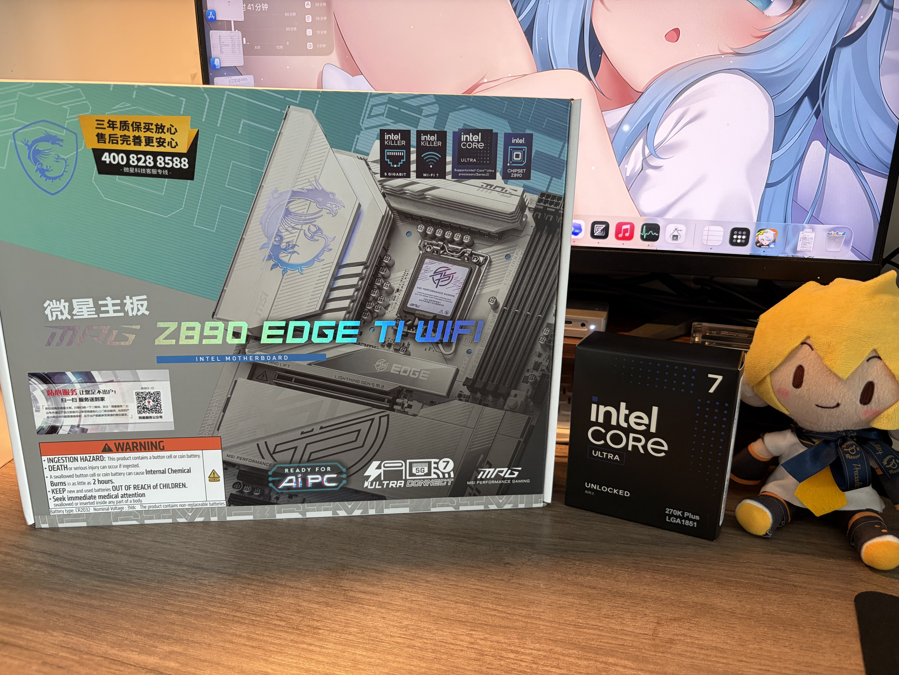

显卡的话，我最开始是想着只作为开发机用，显卡暂时不用，于是我就无显卡状态用了一段时间。

但是，不能玩游戏心痒痒，思来想去还是准备搞一个游戏显卡。因为众所周知的原因，对于linux用户来说A卡是最合适的，而且A卡的性价比也很高，可以说是双向奔赴了（

装机的时间是2026年9月份，这个时间点显卡和内存已经涨到了一个匪夷所思的地步了，因此价格仅供参考（

两三千元价位，有人推荐了RX7800XT，闲鱼二手2900左右，16G显存，相似性能的有RX9070GRE，12G显存，但是架构更新，FSR4.1这种技术支持更好，而且7800XT都是好几年的老卡了，买了也没多久保修了。虽然有人建议大显存，最终为我还是选了9070GRE，闲鱼买了一个全新未拆封的，3700元。

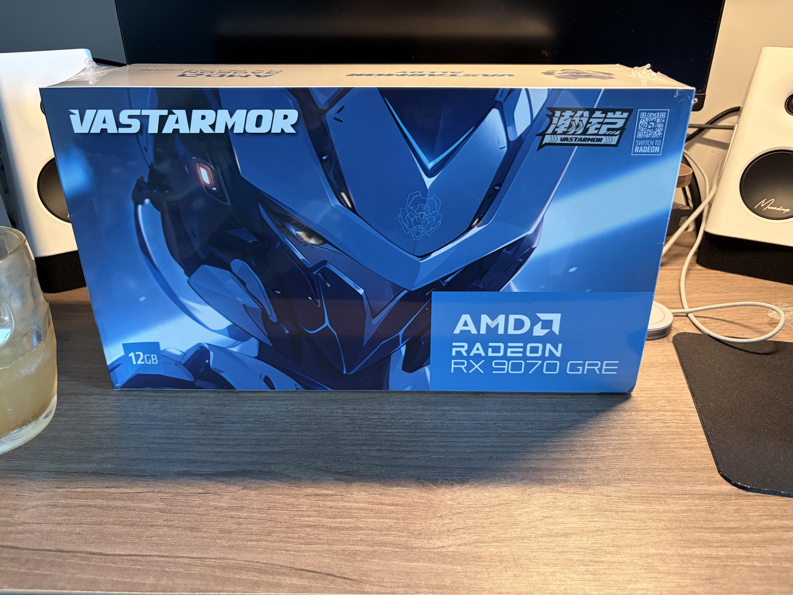

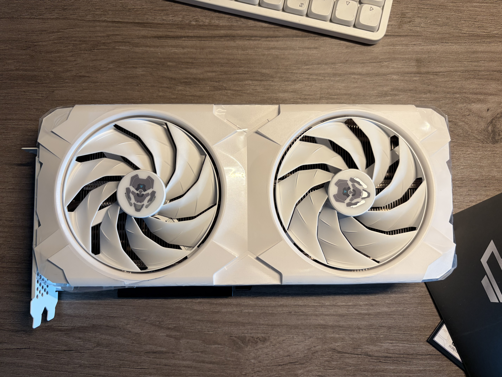

## 内存与存储
内存是最烦人的，自2025年下半年以来，D5内存以及涨价快3倍了，目前16G的内存大概要一千三四，对于装机的人来说太痛苦了。

我最初是选择了很多装机人的做法：先搞16G的过度，于是948元买了群友的8x2的4800MT/s的内存。但是用了一段时间太折磨了，我用linux还好些，用windows时开机直接占用8GB，打开几个软件就快满了，linux下编译时也经常oom，非常痛苦。

在用了一个多月16G内存后（也就是10月5号），我把之前买的8GB的radxa dragon q8b开发板卖掉了，准备换成16x2的。也感谢之前出我内存的群友，他的16x2的d5也想卖，于是让我把8x2的寄给他，然后补一些差价，把他16x2的给我了，不然我还得操心把8x2的内存卖掉（

最终2100元拿下了16x2 6000MT/s的内存
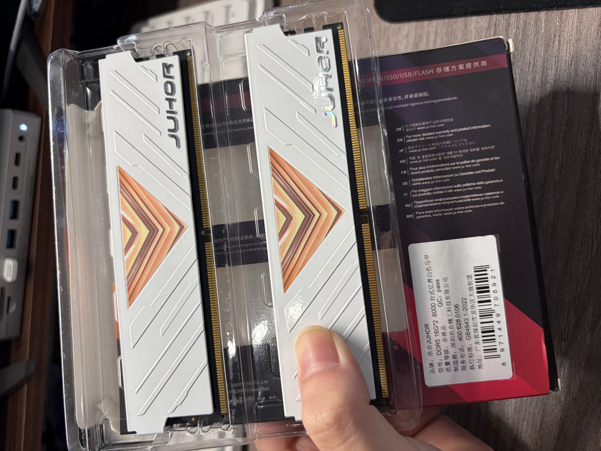

SSD这块儿没啥好说的，我25年年初花400出头买了1T的PCIE4.0x4的固态（忆往昔😢

装archlinux单系统用了一个多月，本来想着虚拟机装win来尝试显卡直通打游戏，但是当时16G内存是在捉急，于是买了一块1T的PCIE3.0x4的固态，花费560元😢，再加上之前用在q8b上的256G PCIE3.0x4的，一共插了3块SSD。
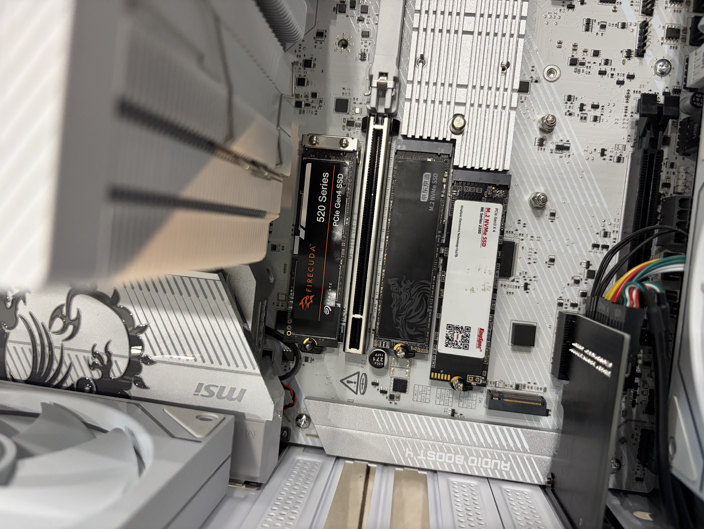

## 机箱与装机

我直接抄答案买的乔思伯松果D41

这个松果d41机箱实际上是m-atx机箱但是兼容atx主板，体积小了很多，但是基本没有理线空间，但是体积小就是好文明（

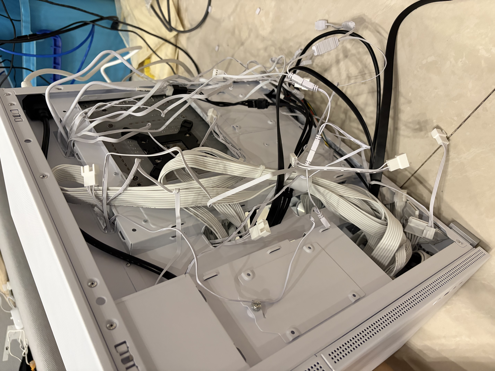

## IPKVM与远程控制

之前为了搞开发板买了一些IPKVM产品，Luckfox Pico KVM推出了主机拓展板，可以直接用KVM的GPIO控制主机的开关机和重启，有了这个，我就可以在外面直接控制电脑重启，可以进bios和切换双系统

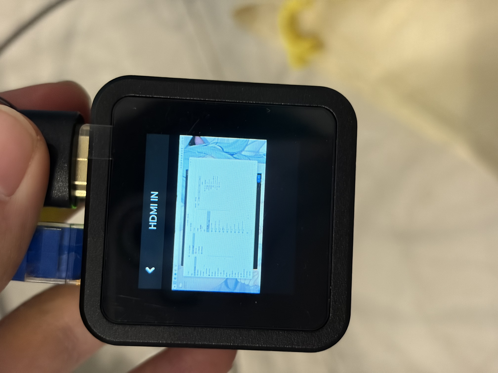

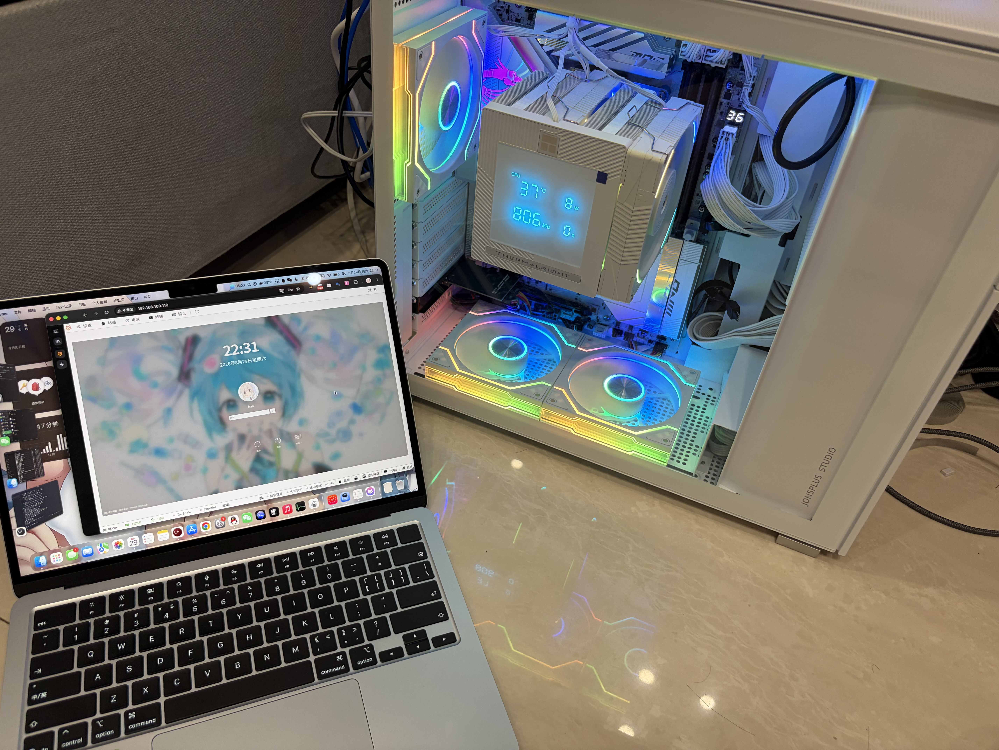

## 总结

看看图片吧，写累了（
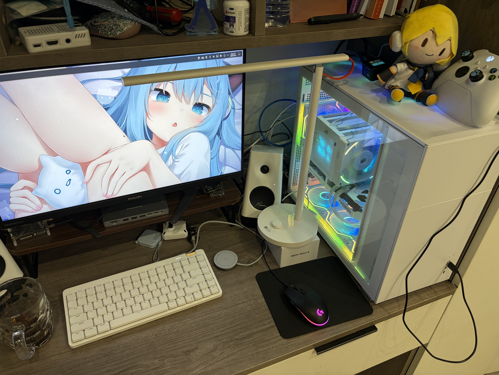

以及经典的fastfetch
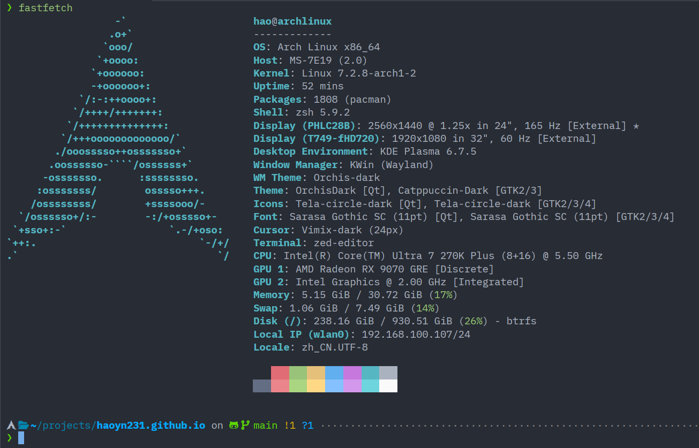

整机预算如下（其中修改一下，内存是2100元的D5，SSD加一根560元的1T，风扇多了一把同款的）

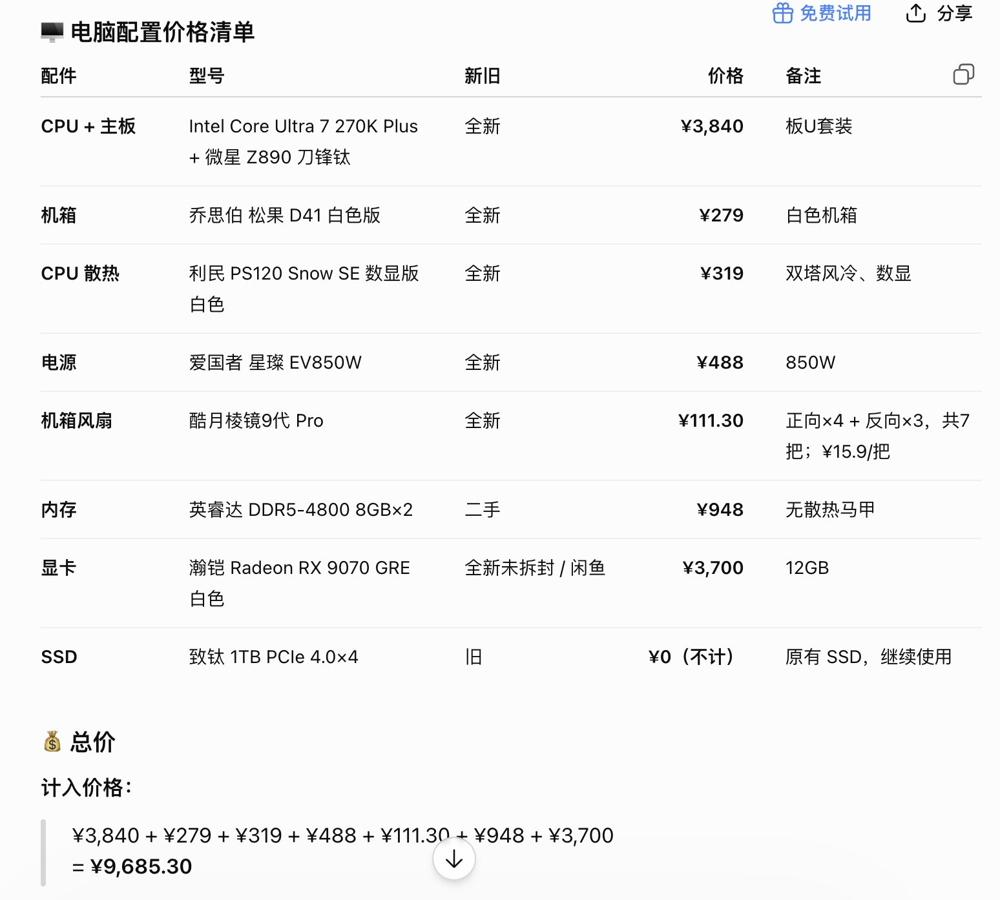
